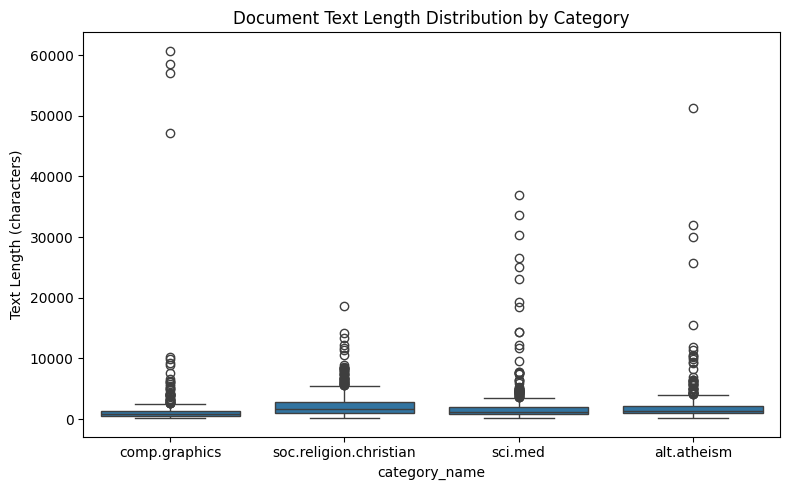
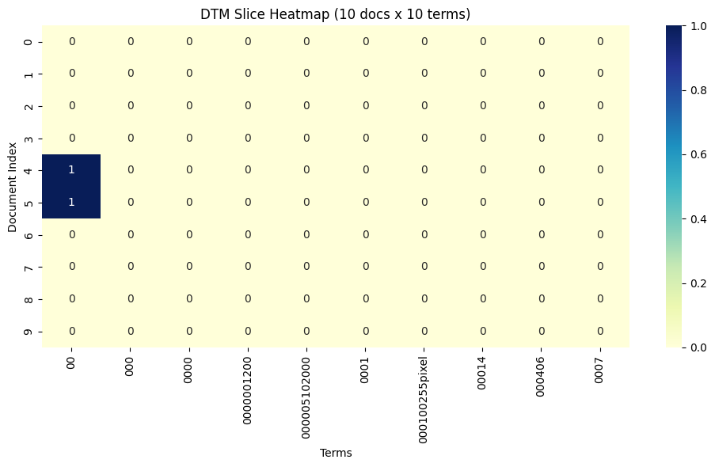
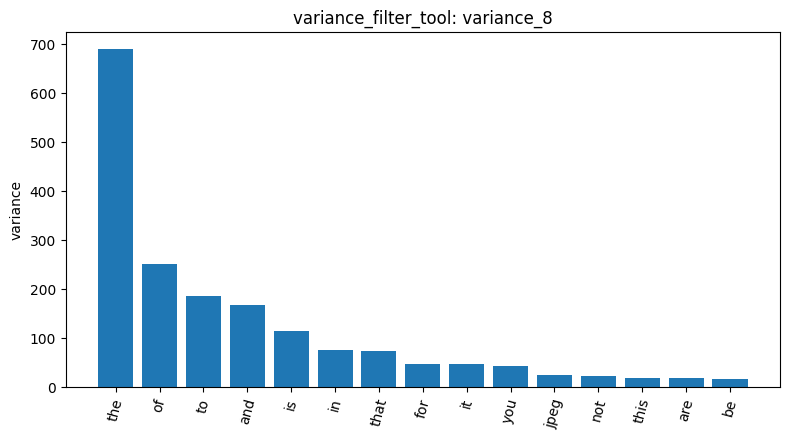
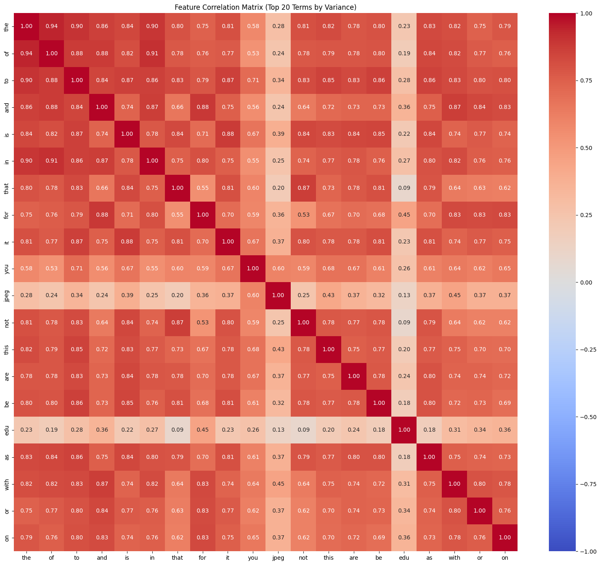
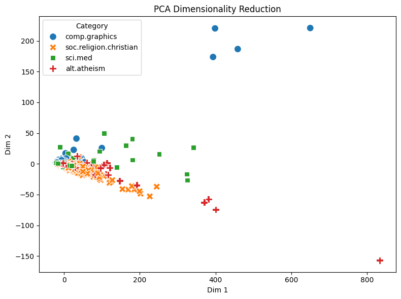
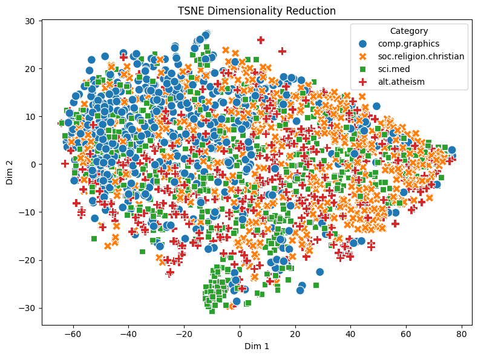

# AgenticPipeline Report: 20-newsgroups

劉俊吾 (115062506)

## Overview

I directed the analysis agent through the Lab 1 pipeline on four 20-newsgroups categories (alt.atheism, soc.religion.christian, comp.graphics, sci.med), using the tools I built in AgentDev. Before approving the one-time access grant, I asked the agent which tools it would unlock and which of them change session data. It confirmed that all 18 of my tools are unlocked at once, and that `check_duplicates_tool` (with `drop=True`), `sample_data_tool`, `tokenize_tool`, `binarize_labels_tool` and `build_dtm_tool` modify the session. I chose not to subsample, so every number below comes from the full dataset and can be compared with the Master notebook. I did not run the missing-value, duplicate or tokenization tools in this session.

The main finding is that, without preprocessing, the raw text signal comes mostly from things that have nothing to do with the topics: Usenet email headers, stop words, a few very long documents, and the signature of one frequent poster.

## 1. Data and document length

`load_dataset_1` loaded 2,257 documents: soc.religion.christian 599, sci.med 594, comp.graphics 584, alt.atheism 480. The first three rows (`inspect_data_2`) show that every document begins with a header block (`From:`, `Subject:`, `Organization:`, `Lines:`), so header words and email domains are part of the text that every later tool sees.

`describe_data_3` measures length in characters. The overall median is 1,235 and the mean is 1,993, with a maximum of 60,713, so the distribution is strongly right-skewed. comp.graphics has the shortest typical post (median 883) but the largest standard deviation (4,685, three times its mean of 1,557) and the longest document in the dataset. The box plot shows a few extreme comp.graphics outliers above 45,000 characters. Inspecting row 1890 (`inspect_data_4`) confirmed that it is the 60,713-character document, "(17 Apr 93) Computer Graphics Resource Listing : WEEKLY [part 1/3]", a 1,566-line resource list rather than a normal discussion post. Documents like this can dominate any statistic built on raw counts.

## 2. Document-term matrix and term frequency

The default document-term matrix (`dtm_5`) has 2,257 documents × 35,788 terms, with only 365,886 non-zero entries (sparsity 99.55%). That is about 162 distinct terms per document out of a vocabulary of almost 36,000. The vocabulary is sorted alphabetically, so it starts with numeric tokens such as `00`, `000`, `0000001200` and `000100255pixel`. As a result, the heatmap of the first 10 terms × first 10 documents (`dtm_heatmap_7`) is almost empty: only 2 of 100 cells are non-zero (documents 4 and 5 each contain `00` once). A slice chosen by position shows sparsity, not content.

Term frequency (`term_freq_6`, 691,079 tokens in total) gives the same picture. The top 20 terms are all function words (`the` 29,825, `of` 17,660, `to` 17,222, ...) except for `edu` at rank 16 (4,675). `edu` comes from email addresses and university domains in the headers (for example `cs.ucsd.edu` in document 2), which the tokenizer splits at the dots. Raw frequency therefore ranks grammar and metadata above topic words.

## 3. Variance filtering and the correlation matrix

With a variance threshold of 0.01 (`variance_8`), 5,354 terms are kept and 30,434 are removed. With 0.1 (`variance_9`), only 995 are kept and 34,793 are removed, which is 4,359 fewer. Both runs keep `the`, `of`, `to`, `and`, `is` at the top. In the bar chart of `variance_8`, the variance of `the` (about 690) is far above every other term, and `jpeg` is the only non-function word in the top 15. In raw counts, frequent words vary the most simply because documents differ in length, so high variance does not mean a term is useful for telling topics apart. I would keep 0.01, because 0.1 already removes ordinary content words (the removed sample includes `passage`, `friend`, `resource`). A variance threshold works better after stop-word removal or TF-IDF weighting.

The correlation matrix of the 20 highest-variance terms (`feature_corr_13`) shows the length effect directly. Function words correlate strongly with each other (`the`–`of` 0.94, and most pairs are above 0.7) because they all grow with document length. `jpeg` and `edu` are the exceptions. `jpeg` correlates only about 0.2–0.45 with the function words (its highest value is 0.60, with `you`), and `edu` only 0.09–0.45. The likely reason is that `jpeg` is concentrated in a few comp.graphics posts such as FAQs and resource lists, and `edu` depends on the headers rather than on body length. I did not check which documents contain `jpeg`, so this explanation is a hypothesis.

## 4. Pearson vs. Spearman feature selection

For comp.graphics, Pearson (`pearson_filter_10`) ranks `thanks` (+0.2778) first, followed by `keywords` (+0.2330), `looking` (+0.2135), `vga` (+0.2111) and `video` (+0.2095). The negative terms are `re` (−0.2566), `writes` (−0.2337), `who`, `people` and `that`. The word `graphics` is not in the top 10. Spearman (`spearman_filter_11`) puts `graphics` first (+0.5211) and `files` (+0.3167) in the top 10; the other eight are negatively correlated function words (`that` −0.3906, `of` −0.3333, ...). Spearman works on ranks, so it mainly rewards a term that is consistently present in the target class and absent elsewhere, which is exactly the case for `graphics`. Pearson works on raw counts and is pulled by a few documents with very large counts. Its positive terms describe the question-asking style of the group (`thanks`, `looking`). The negative terms point to the other groups: `re` and `writes` come from quoted replies ("Re:" subjects, "X writes:"), which are common in the long religion debates, and so does `people`.

For sci.med, Pearson (`pearson_filter_12`) returns no medical terms at all: `pitt` 0.3795, `gordon` 0.3552, `geb` 0.3447, `banks` 0.3444, `n3jxp` 0.3208, `chastity` and `intellect` 0.3174, `cadre`, `dsl` and `shameful` 0.3166. These look like the name, email address and signature quote of one frequent sci.med poster. The words of a signature appear together in every post by that person, so they correlate with the label. Here Pearson identifies an author, not a topic, which is a form of leakage.

## 5. Frequent pattern mining

I mined the top 10 patterns for sci.med (`mine_patterns_14`) and comp.graphics (`mine_patterns_15`) with TF-IDF vocabulary filtering and the Top-K algorithm. In sci.med, `subject` has support 594 (every document), `lines` 585, `organization` 582, {`lines`, `subject`, `organization`} 573 and `edu` 416. comp.graphics gives nearly the same list: `lines` 584, `subject` 584, `organization` 560 and `edu` 320. My mining tool removes English stop words, but header field names are not stop words, so they survive and fill the top 10 in both categories. Patterns with the same near-100% support in every class cannot separate classes. Headers have to be removed, or patterns shared across categories filtered out, before mining can show topic patterns.

## 6. Dimensionality reduction

PCA (`reduce_dims_16`) explains 65.94% of the variance with PC1 and only 4.33% with PC2. In the plot, most documents are packed near the origin, while a few points stretch far along Dim 1 (up to about 800), and four comp.graphics points sit far above the rest (Dim 2 ≈ 175–220). The category centroids on PC1 are ordered comp.graphics (−9.03) < sci.med (−2.28) < alt.atheism (3.74) < soc.religion.christian (8.06). This is exactly the order of the median lengths in `describe_data_3` (883 < 1,238.5 < 1,382.5 < 1,649), so PC1 is mainly a document-length axis. The four isolated comp.graphics points match the four very long comp.graphics outliers in the box plot. The large centroid gap between comp.graphics and soc.religion.christian is therefore at least partly a difference in post length.

t-SNE (`reduce_dims_17`, perplexity 30, random_state 42) also places comp.graphics (centroid −20.61, 5.17) and soc.religion.christian (16.45, 1.19) at opposite ends. In the plot, comp.graphics leans to the left, soc.religion.christian to the right, and there is one small, separate sci.med cluster at the bottom (around Dim 2 ≈ −28). Otherwise the four categories overlap heavily in the middle. The agent described the result as tight clusters with clear boundaries, but the plot does not show that. t-SNE preserves local neighbourhoods, and the distances between clusters or centroids are not meaningful the way PCA coordinates are, so I only read it qualitatively.

## 7. Label encoding and document similarity

`binarize_labels_18` converted the labels to one-hot vectors in the order alt.atheism, comp.graphics, sci.med, soc.religion.christian. Unlike the integer codes 0–3, one-hot vectors do not imply a false order or false distances between categories.

The cosine similarity of documents 0 and 1, both comp.graphics, is 0.3532 (`cosine_sim_19`). For documents 0 and 2 (comp.graphics vs. soc.religion.christian) it is 0.3399 (`cosine_sim_20`), a difference of only 0.0133. With raw counts, the vectors are dominated by the function words and header tokens that all posts share, so cosine similarity hardly separates topics. These are only two pairs, so they illustrate the problem rather than measure it.

## Conclusion

The same problem appears at every stage: on raw counts, topic-independent signals dominate term frequency, variance filtering, Pearson selection, pattern mining, PCA and cosine similarity. These signals are email headers, stop words, document length, very long list-style posts and one poster's signature. Only Spearman ranked a clear topic word (`graphics`) first. Before these tools can say anything about the topics, the next step is to strip headers and signatures, remove stop words, use TF-IDF or length normalization, and then rerun the filters, the mining and the PCA.
