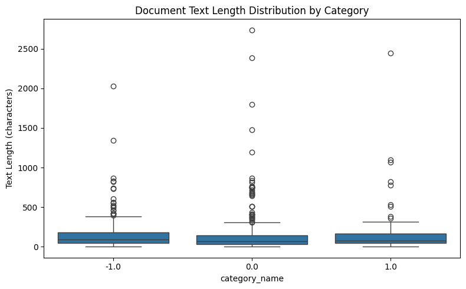
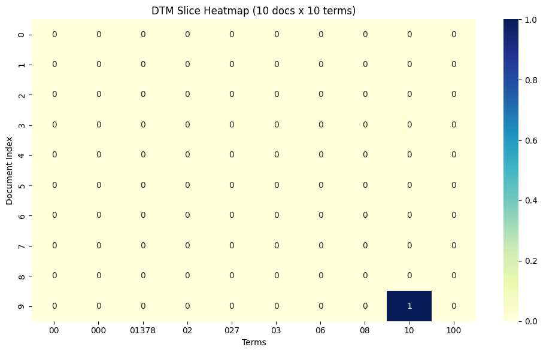
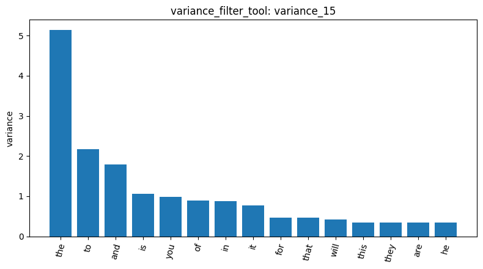
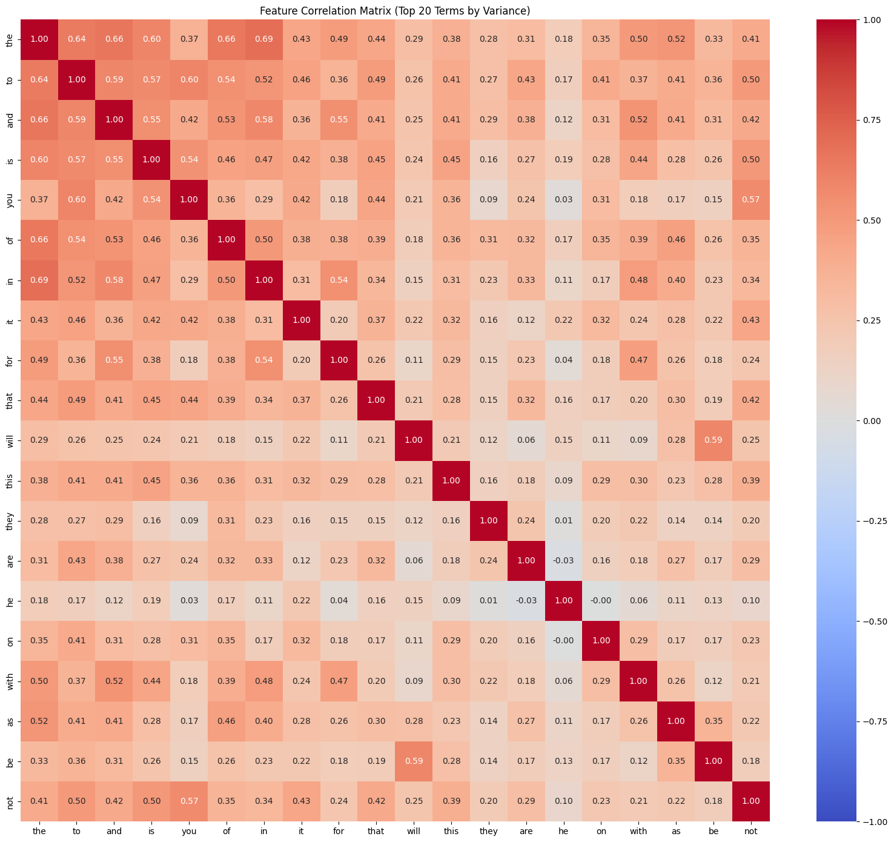
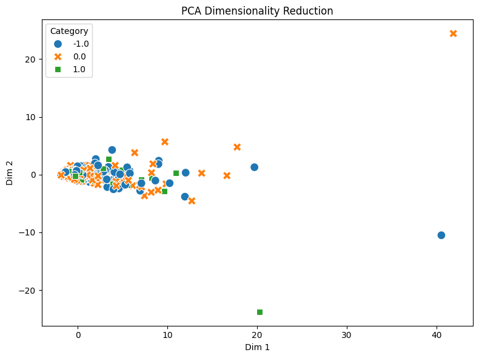
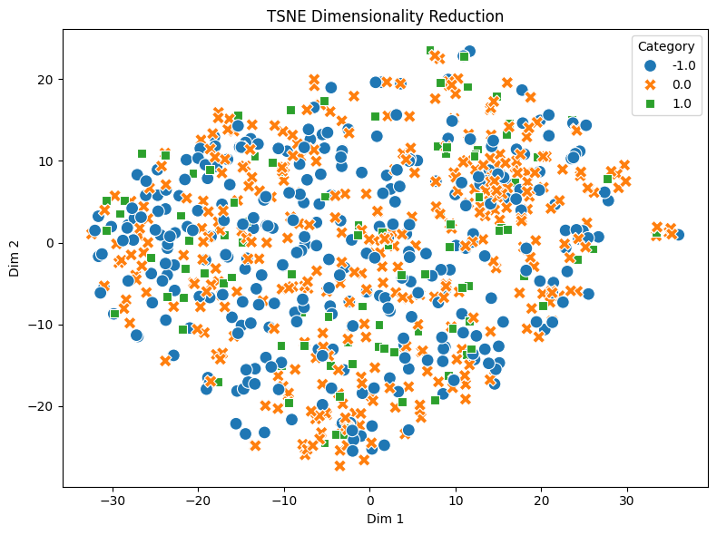
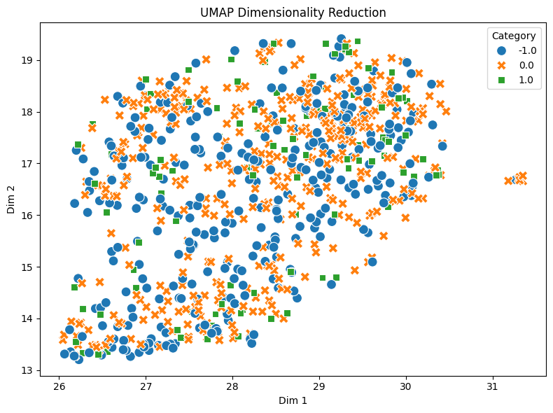

# Homework Report: Reddit Stock Sentiment

劉俊吾 (115062506)

## Overview

I ran the same 18 tools from AgentDev on `newdataset/Reddit-stock-sentiment.csv`, a set of Reddit posts and comments about stocks labelled with three sentiment classes. Before approving the one-time access grant, I asked the agent which results would become invalid if I later dropped duplicates. It answered that the document-term matrix (DTM) and everything computed from it would have to be rebuilt, so I planned the order of my steps around that.

Every tool ran without errors on this dataset, even though it has three string labels (`-1.0`, `0.0`, `1.0`) instead of the four newsgroup names my tools were tested on. The results, however, mean something quite different from the 20-newsgroups run in my AgenticPipeline report. The texts are very short, the noise comes from bots, markup and promotional posts instead of email headers, and sentiment turns out to be much harder to capture with single words than topic was. I did not run `tokenize_tool`, `sample_data_tool` or `list_files_tool` in this session.

## 1. Data, missing values and duplicates

`load_dataset_1` loaded 847 documents: `0.0` (neutral) 423, `-1.0` (negative) 315 and `1.0` (positive) 109. The positive class is about a quarter of the size of the neutral one. The first rows (`inspect_data_2`) show how short and informal the texts are: "Calls on retards" (`-1.0`), "Seeing lots of red in the ticker." (`0.0`). The second example also shows a domain problem: in stock slang "red" means falling prices, which a bag-of-words model cannot know.

`check_missing_3` found no missing or blank documents. However, `describe_data_4` shows a minimum length of 1 character, and row 798 (`inspect_data_5`) contains only `/`. A text like this is not "missing", but it contains no word that the vectorizer keeps, so it becomes an all-zero row in the DTM. The length statistics are very different from 20-newsgroups: the median is 78 characters (mean 147, maximum 2,737). Negative posts are the longest (median 96), followed by positive (81) and neutral (68).

`check_duplicates_6` reported 23 duplicates without dropping anything. Row 105, a duplicated row (`inspect_data_7`), is just a link, `[World Markets (stockbuyvest.com)]()`, labelled neutral. This suggested that some duplicates are automatic bot posts, so I measured their effect before deciding whether to drop them.

## 2. Effect of the duplicates

On the full 847 documents, the DTM (`dtm_8`) had 4,346 terms. The Pearson filter for the neutral class (`pearson_filter_9`) ranked `com` (+0.1422), `stockbuyvest` (+0.1422) and `updated` (+0.1250) among its top 10. These words come from the link templates of the bot posts, which are repeated and all labelled neutral, so the filter mistook them for markers of neutral sentiment.

I then dropped the duplicates (`check_duplicates_10`). The tool removed 34 rows, not 23, because it uses `keep=False` and deletes every copy, including the first one. That leaves 813 documents (`0.0` 391, `-1.0` 315, `1.0` 107). For bot posts, removing every copy is reasonable. For genuine short comments that happen to repeat, it would remove real data, so this is a trade-off. After rebuilding the DTM (`dtm_11`, 813 × 4,313), the neutral Pearson list (`pearson_filter_12`) no longer contains `com`, `stockbuyvest` or `updated`. All results below are on the 813 cleaned documents.

The cleaned neutral list is also revealing. Eight of the ten terms are negatively correlated with the neutral class (`economy` −0.1495, `he` −0.1366, `his`, `trump`, `will`, `trade`, `doing`, `him`); only `year` and `always` are positive (+0.1005, +0.1004). The neutral class is therefore defined mostly by what it lacks, the political and economic topics, rather than by words of its own.

## 3. Document-term matrix and term frequency

`dtm_11` has 16,659 non-zero entries out of 3,506,469 cells, a sparsity of 99.52%. That is almost the same as 20-newsgroups (99.55%), although the documents here are about sixteen times shorter by median length. The vocabulary shrinks along with the documents (4,313 terms instead of 35,788), so the proportion of non-zero cells stays about the same. Term frequency (`term_freq_13`, 20,315 tokens) is again topped by function words (`the` 874, `to` 554, `and` 471). Unlike 20-newsgroups there is no header token such as `edu`, but `he` ranks 16th (132), which points to the many posts about one person. The 10 × 10 heatmap slice (`dtm_heatmap_14`) contains a single non-zero cell (document 9, term `10`). The slice takes the alphabetically first terms, which are numbers, so it shows the sparsity rather than any content.

## 4. Variance filtering and the correlation matrix

A variance threshold of 0.01 (`variance_15`) keeps 490 of 4,313 terms. A threshold of 0.1 (`variance_16`) keeps only 45, whereas in my 20-newsgroups run 0.1 still kept 995. In short texts most words occur 0 or 1 times in a document, so their variance is small (at most 0.25 for a 0/1 variable), and a fixed threshold removes far more terms. The threshold therefore has to be chosen per dataset. Here I would use about 0.01, or keep a fixed number of top terms instead. The bar chart of `variance_15` shows that `the` (about 5.1) dominates; every other term in the top 15 is below about 2.2, and the list contains only function words plus `will` and `he`.

The correlation matrix of the 20 highest-variance terms (`feature_corr_21`) contains only function words plus `will` and `he`. The strongest pair is `the`–`in` at 0.6922, followed by `the`–`and` 0.6591 and `will`–`be` 0.5906, and some pairs are close to zero (`you`–`he` 0.0262). In 20-newsgroups, function words correlated up to 0.94 because they all grow with document length. Short posts have a much smaller range of lengths and rarely contain many function words at once, so this length effect is weaker here.

## 5. Pearson and Spearman feature selection

For the negative class (`pearson_filter_17`), the top terms are `he` 0.1762, `his` 0.167, `will` 0.1546, `trump` 0.1506, `fuck` 0.1337, `china` 0.1256, `him` 0.1222, `economy` 0.119, `trade` 0.1145 and `until` 0.1107. Apart from `fuck`, these are not sentiment words but the topic of US politics and trade. A classifier built on them would learn "posts about Trump or China are negative", and it would fail as soon as the news changed or someone wrote positively about a trade deal. This is topic confounding: the label is correlated with a topic, not only with the expressed sentiment.

For the positive class (`pearson_filter_18`), `huge`, `main` and `tldr` share exactly the same score (0.1563), followed by `nice` 0.1555 and `technology` 0.1525. Identical scores mean the three terms have the same distribution across documents, so they most likely come from the same few posts. `main` and `tldr` are not sentiment words but the section labels of promotional posts. Row 3 (`inspect_data_19`) is one such post, an enthusiastic write-up of Vision Marine Technologies. With only 107 positive documents, a handful of templated posts is enough to reorder the top of the list.

Spearman for the positive class (`spearman_filter_20`) gives almost the same list (`technology` 0.1609, then `huge`, `main`, `tldr` 0.1563, `nice` 0.1555). In 20-newsgroups the two methods disagreed strongly: `graphics` was first in Spearman (0.5211) but missing from Pearson's top 10. The difference disappears here because short-text counts are nearly all 0 or 1, and for such values ranks and raw counts carry the same information. Also, the strongest correlation in any class is only about 0.18, compared with 0.52 for a newsgroup topic. Sentiment is spread over many different words that every class shares, while a topic has words of its own.

## 6. Frequent pattern mining

With TF-IDF filtering and Top-K (k = 10), the negative class (`mine_patterns_22`) yields `trump` 45, `just` 42, `china` 33, `like` 25, `think`, `people` and `market` 23, `going` 21, `money` 19 and `make` 18. The positive class (`mine_patterns_23`) yields `just` 15, `good` 12, `doing` 9, `like` and `going` 8, then `think`, `time`, `economy`, `way` and `new`. Every pattern is a single word. In 20-newsgroups the top patterns were combinations of header fields such as {`subject`, `lines`, `organization`}. In posts this short, two filtered words rarely appear together often enough to beat a single word's support. Topic words such as `trump` lead in the negative class, while the positive class at least has `good`; the shared filler words (`just`, `like`, `think`) cannot separate the classes. Switching the positive class to term-frequency filtering (`mine_patterns_24`) gives ten different words, all with support 4. This shows how unstable the patterns of a small class are.

## 7. Dimensionality reduction

PCA (`reduce_dims_25`) explains 26.70% of the variance with PC1 and 5.12% with PC2, compared with 65.94% for PC1 on 20-newsgroups. The class centroids all sit close to the origin, but their order on PC1 is `0.0` (−0.2228) < `1.0` (0.0343) < `-1.0` (0.2649). This is exactly the order of the median lengths in `describe_data_4` (68 < 81 < 96), so PC1 is again mainly a length axis. It explains less here because the posts vary less in length. In the plot, almost all points form one dense blob, with a few long posts stretching out along Dim 1.

t-SNE (`reduce_dims_26`) and UMAP (`reduce_dims_27`) do not separate the classes either. The three classes are completely mixed, and the UMAP centroids are almost identical (from (28.16, 16.33) to (28.40, 16.73)). Both plots, however, show one small isolated group on the right (t-SNE Dim 1 ≈ 33–36, UMAP Dim 1 ≈ 31.3). Row 686 (`inspect_data_28`), one of the documents in that group, is just the Reddit emote markup ``. After tokenization, every post containing this markup shares the same tokens (`img`, `emote`, `t5_2th52`), so they cluster together regardless of their label. This is the Reddit equivalent of the 20-newsgroups email headers: structure produced by the platform's formatting, not by the content.

## 8. Label encoding and document similarity

`binarize_labels_29` encodes the labels as one-hot vectors in the order `-1.0`, `0.0`, `1.0`. For the four newsgroup topics, one-hot encoding was the right choice because topics have no order. Sentiment does have an order (negative < neutral < positive), and one-hot encoding throws it away: confusing negative with positive costs the same as confusing negative with neutral. For a regression or ordinal model, or for averaging a daily sentiment score, keeping the values −1, 0, 1 would be more useful.

Cosine similarity on raw counts reflects shared wording rather than shared sentiment. Rows 0 and 1 (`cosine_sim_30`) have a similarity of exactly 0.0, because the two short texts share no word. Rows 3 and 163 (`cosine_sim_31`), both positive, have 0.3731. Both are long promotional write-ups about small companies ("Vision Marine Technologies Inc. is rewriting...", "Just stumbled upon some exciting news about Star N..."), so they share the vocabulary of a template rather than any sentiment words. These two pairs only illustrate the problem; they do not measure it across the dataset.

## 9. Comparison with 20-newsgroups

| | 20-newsgroups (AgenticPipeline) | Reddit (this run) |
| --- | --- | --- |
| Documents / classes | 2,257 / 4 topics | 813 after cleaning / 3 sentiments |
| Median length | 1,235 characters | 78 characters |
| DTM sparsity | 99.55% | 99.52% |
| Terms kept at variance threshold 0.1 | 995 | 45 |
| Highest function-word correlation | 0.94 (`the`–`of`) | 0.69 (`the`–`in`) |
| Pearson vs. Spearman | very different | nearly identical |
| Strongest class correlation | 0.52 (`graphics`) | about 0.18 (`he`) |
| Top patterns | header-field combinations | single words |
| PC1 explained variance | 65.94% | 26.70% |
| Main non-content signal | email headers, signatures | bot links, emote markup, promotional templates, political topics |

## Conclusion

My tools generalize: all of them ran unchanged on a dataset with different labels, sizes and text style. The results show, however, that the same methods can mean different things on different data. Short texts make variance thresholds, the gap between Pearson and Spearman, and multi-word patterns behave differently. Duplicated bot posts and Reddit markup create spurious features and clusters in the same way that email headers did in 20-newsgroups. Most importantly, the negative label is entangled with one political topic, so the strongest "sentiment" features are really topic features. Before training a sentiment model on this data, I would remove bot posts and markup, drop texts with no tokens, remove stop words and use TF-IDF. I would also add n-grams or negation handling, so that phrases like "not good" or "red ticker" keep their meaning.
